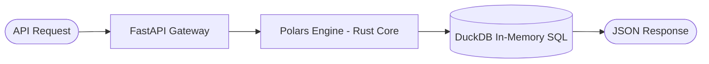

cat << 'EOF' > README.md
# High-Performance AI Analytics Engine

[](https://fastapi.tiangolo.com)
[](https://pola.rs)
[](https://duckdb.org)
[](https://www.docker.com)
[](https://python-poetry.org)

An enterprise-grade, high-throughput analytics backend built for **AI Infrastructure & Telemetry** workloads, processing **1,000,000+ rows** with low latency (~133ms) via Polars and DuckDB zero-copy Apache Arrow integration.

## ⚡ Tech Stack & Architecture
* **FastAPI:** Asynchronous Python web framework for REST endpoints
* **Polars:** Rust-backed multi-threaded DataFrames
* **DuckDB:** In-process OLAP SQL on Arrow buffers
* **Docker & Poetry:** Containerized builds and dependency management



## 🚀 Getting Started
```bash
# Docker
docker build -t ai-infra-engine . && docker run -p 8000:8000 ai-infra-engine

# Local (Poetry)
poetry install && PYTHONPATH=. poetry run uvicorn app.main:app --reload
```
EOF
git add README.md && git commit -m "docs: clean up README.md" && git push
